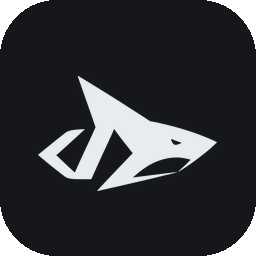
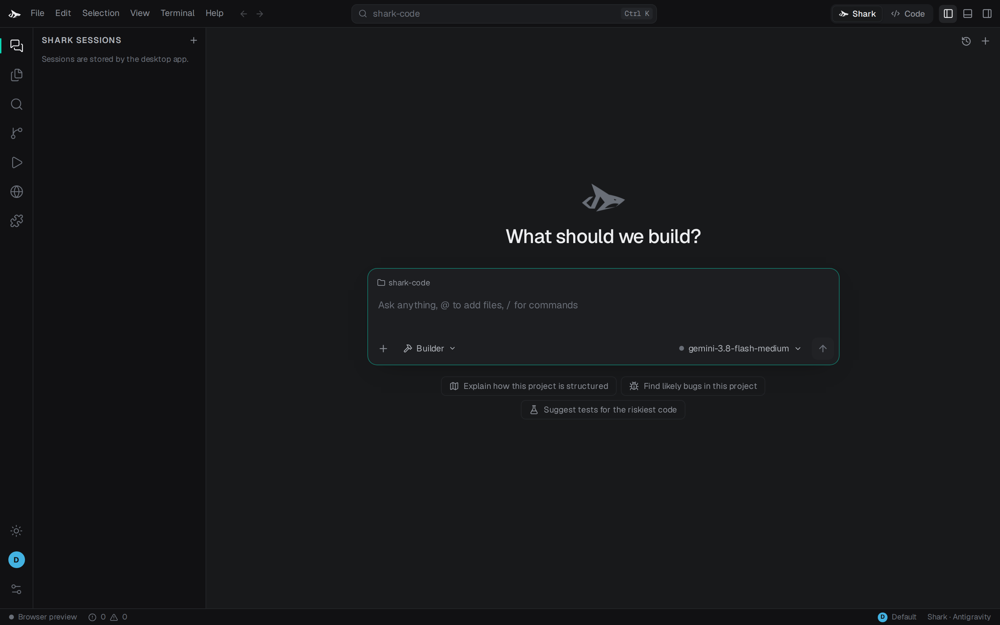
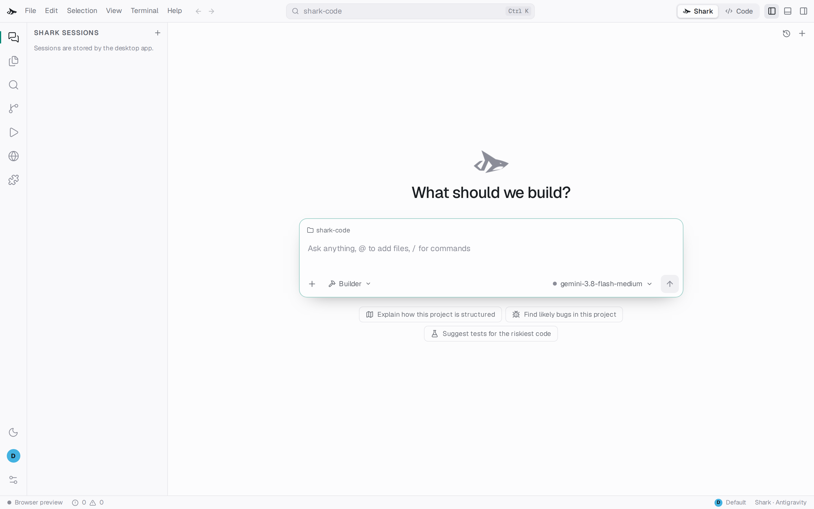

<div align="center">



# Shark Code

A desktop code editor built around an agent. Use Claude Code, Codex, Antigravity, Muse or your own API key, review every change, then apply it.

[-orange)](#status)
[](LICENSE)


</div>



## Why

Coding agents are good at writing code and bad at telling you what they did. Most run in a terminal, edit your files directly, and leave you to work out the result from a scrolling log.

Shark Code puts the agent in the middle of an editor. You see each step as it happens, every edit comes back as a reviewable change, and the files on disk stay untouched until you apply it. The agent can be any CLI you already use, or an API key, and the UI works the same for all of them.

## How a run works

1. You ask Shark something in the chat, optionally attaching files or picking a mode.
2. Shark copies your project to a private folder and gives the engine a short map of the relevant code from its code graph.
3. The engine works in that copy. Its thinking, tool calls and messages stream into the chat.
4. When it finishes, Shark compares the copy with your project and turns the differences into a proposal: a list of created, edited and deleted files with inline diffs.
5. You review and apply, or discard. Applying checks that the files have not changed since the run started.

Read-only modes (Adversarial review, Planner, Explain) never produce a proposal. Any edits the engine makes in its copy are thrown away.

## Engines

| Engine | Kind | Setup |
| --- | --- | --- |
| Claude Code | CLI | `claude` installed and signed in |
| Codex | CLI | `codex` installed and signed in |
| Antigravity | CLI | `agy` installed and signed in |
| Muse | CLI | `muse` installed and signed in |
| OpenRouter | API key | Key in Settings, or `OPENROUTER_API_KEY` |
| Anthropic | API key | Key in Settings, or `ANTHROPIC_API_KEY` |
| Gemini | API key | Key in Settings, or `GEMINI_API_KEY` |

Shark finds installed CLIs on your `PATH` and in common install folders. Pick the engine, model and effort level from the model button in the chat box, or type `/model`, `/effort` or `/engine`. Slash commands from Claude Code (`.claude/commands`) and Codex (`~/.codex/prompts`) also show up under `/`.

You can run the same request on several engines at once from the mode menu ("Also run on"). Each result opens as its own tab.

## Features

**Chat**
- Modes: Chat, Builder, Debugger, Adversarial review, Planner, Explain, Test writer, Refactor. Each mode sends the engine a fixed brief; Chat is the free-form default — just talk, no forced build/review/plan structure.
- Skills change how Shark writes (concise, teacher, senior, caveman), and you can add your own.
- Step timeline with live status. Subagent steps nest under the step that started them.
- A run timer while working, and the total time when done.
- Context fill, prompt cache use, compaction and provider retries shown next to the chat box and in the thread.
- Clear errors for quota, rate limits, sign-in, network and full context, each with a next step.
- Session management in the sidebar: conversations sort newest first, are searchable by title, and can be deleted individually.

**Durable workflows**
- Multi-step plans keep a private candidate, checkpoints, evidence and bounded context across engine invocations.
- Pause, continue, retry failed steps, answer questions and stop from the conversation.
- Configured checks run in the candidate. Failed checks can trigger bounded repairs; changes invalidate earlier passing checks.
- Final source application still requires human review. Restarted runs resume explicitly from saved checkpoints.
- See [orchestration](docs/architecture/orchestration.md) for APIs, budgets and execution limits.

**Code intelligence (all 10 categories bundled)**
- **Structural & AST (17 languages):** Bundled Tree-sitter grammars for Python, TypeScript, TSX, JavaScript, Rust, Go, Java, C, C++, C#, Ruby, Kotlin, PHP, Scala, Lua, Bash/Shell and Zig with incremental AST caching, rich symbol signatures, RPC/HTTP contracts, SQL schema/query extraction (`sqlglot`), and subsystem clustering.
- **Dependencies & SBOM:** `tsconfig`/`jsconfig` alias resolution, workspace manifests, verified unused packages and undeclared imports, SemVer/PEP-440 compatibility and peer conflict solver (`packaging`), bundled offline OSV advisories, license classification and CycloneDX 1.5 SBOM generation.
- **Semantic & Intent:** Local dense LSA/SVD concept & identifier vector search (`numpy`) alongside FTS5 BM25 lexical search, domain vocabulary extraction, Type-1/2/3 AST clone detection (`rapidfuzz`), design pattern detection and behavioral explanations.
- **Change Impact:** Unified Graphify blast-radius and module graph (including HTML `<script>`/`<link>` and path aliases), cross-file caller resolution, base-vs-candidate semantic diff, contract break checks, SQL migration validation and calibrated regression risk scoring.
- **Quality & Debt:** Standardized Sonar-style cognitive complexity, Radon Halstead & SEI Maintainability Index (`radon`), LCOM4 class cohesion (`networkx`), whole-program dead-code analysis (`vulture` + call reachability), docstring consistency (`docstring_parser`), prioritized technical debt and historical baselines.
- **Security & Supply Chain:** Bundled `ast-grep-py` structural rules, intra-procedural and cross-file taint flow tracking, route permission boundary audit, Rust `unsafe`/FFI and C memory review locations, lockfile integrity verification and redacted secret scanning.
- **Runtime & Performance:** Built-in `cProfile` + `tracemalloc` profiler (`intelligence/runtime/collect`), static bottleneck detector (N+1 queries/IO in loops, blocking calls in async), revision-bound runtime event ingestion and bundled Playwright Chromium checks.
- **Architecture & Git History:** Architectural layer inference, Robert C. Martin coupling metrics (`Ca`, `Ce`, instability, abstractness, distance), boundary rules, pure-Python Git history (`dulwich`), symbol evolution, bug-proneness scoring and regression correlation.
- **Agent & Shark Automata Integration:** Stack-trace error correlation (`intelligence/correlate_error`), multi-file refactoring plans (`intelligence/refactor_plan`), 8 built-in `tools/analyze` analyzers (`python-syntax`, `code-stats`, `ast-grep-builtin`, `security-audit`, `dead-code`, `maintainability`, `sql-check`, `sbom`), and 12 `intel.*` nodes, `intel.gate` quality gates, workflow templates and live Intelligence Dock in **Shark Automata**.
- See [core capability status](docs/architecture/core-capability-status.md) for APIs and details.

**Editor**
- Monaco with tabs, breadcrumbs and a command palette.
- Built-in TypeScript, JavaScript, JSON, CSS and HTML support.
- Language servers for Python (pyright), Rust (rust-analyzer), Go (gopls) and C/C++ (clangd), when installed.
- Markdown opens rendered. HTML opens side by side with a live preview.
- Shark view puts the chat in the middle. Code view puts the editor in the middle with Shark docked on the right.

**Browser**
- Preview the project's HTML files or a local dev server.
- Pick any element on the page to find the source lines that render it, then ask Shark to change it.
- Console errors are collected and can be sent to Shark.
- Headless checks with Playwright report console errors and failed requests.

**Git**
- Explorer colours for modified, added, untracked, deleted and conflicted files.
- Stage, unstage, commit, switch and create branches, fetch, pull (fast-forward only) and push.
- Shark can draft a commit message from the staged diff.

**Workspace**
- Terminal, Problems panel, build and test tasks detected from the project, and dependency lists.
- Developer tools are detected and offered as tasks: ripgrep, ast-grep, Semgrep, difftastic, scc, ctags, gh, lazygit, delta.
- Profiles keep settings, keys and layout separate.
- Plugins: ask Shark to build a sidebar panel; manage them in the plugin manager.
- Light and dark themes, a high-contrast option, adjustable text size and reduced motion.

| Empty state | Light theme |
| --- | --- |
|  |  |

## Status

Alpha. It works day to day on Linux, but expect rough edges and breaking changes. macOS and Windows builds have not been tested yet. See [NEXT-SESSION.md](NEXT-SESSION.md) for what is still open.

## Run from source

Needs Node 20+, Rust (stable), [uv](https://docs.astral.sh/uv/) and Python 3.12.

```sh
npm install
npm run backend:setup     # Python runtime + Rust core
npm run tauri dev
```

For page checks when running from source (release builds bundle Chromium):

```sh
uv run --project backend playwright install chromium
```

Optional tools Shark uses when present: ripgrep, ast-grep, Semgrep, difftastic, scc, ctags, gh, lazygit, delta, pyright, rust-analyzer, gopls, clangd.

## Keyboard

| Keys | Action |
| --- | --- |
| `Ctrl K` | Command palette |
| `Ctrl P` | Go to file |
| `Ctrl L` | Focus the chat |
| `Ctrl Shift M` | Switch Shark / Code view |
| `Ctrl B` | Toggle sidebar |
| `Ctrl J` | Toggle terminal |
| `Ctrl S` | Save |
| `Ctrl Shift V` | Markdown preview |

On macOS use `Cmd` instead of `Ctrl`.

## Build a release

```sh
npm run package
```

This builds the Rust core and a single-file Python runtime (PyInstaller) into `src-tauri/binaries/`, then runs `tauri build` with them bundled.

## Tests

```sh
npm run backend:test      # Python runtime
cargo test                # Rust core
npx tsc --noEmit          # frontend types
```

`scripts/engine-playground.py` runs real engines against a small project with a known bug and checks that a correct fix comes back for review. It uses your CLI logins and quota.

## How it is built

| Part | Path | Role |
| --- | --- | --- |
| UI | `src/` | React 19, Monaco, xterm.js |
| Desktop shell | `src-tauri/` | Tauri 2: window, terminal, starts the runtime |
| Runtime | `backend/shark_runtime/` | Python: tasks, engines, code graph, git, language servers, browser, MCP |
| Core | `crates/` | Rust: confined file access, search, outlines, versioned multi-file edits with recovery |

The UI talks to the Python runtime over JSON lines. The runtime uses the Rust core for every read and write, so edits are version-checked and can be reverted. Task history lives in `.shark/` inside your project, which Shark keeps out of git status.

More detail: [docs/backend](docs/backend/README.md).

## Troubleshooting

- **"Required: [...]; optional: [...]" error:** the runtime is older than the app. Use Help → Restart Shark Backend.
- **Window reloads when a run starts (dev only):** restart `npm run tauri dev` so Vite picks up its watch settings.
- **An engine shows as not found:** check that its CLI runs in a terminal and is signed in, then reopen the engine picker.

## License

[Apache 2.0](LICENSE)

### Media and notebooks

Open PNG, ICO, JPEG, GIF, WebP, AVIF and BMP files in the editor for an image preview with fit and zoom controls. Audio and video files open with playback controls; codec availability follows the desktop WebKit/GStreamer installation. Media streams through Tauri's scoped asset protocol instead of the text editor.

`.ipynb` files open as notebooks: edit, add, reorder, convert and delete cells; preview Markdown and saved outputs; run one cell or all cells; interrupt, restart or shut down the kernel; and save outputs with the document. **File → New Notebook** creates a valid notebook. Shark includes a Python kernel and can select locally installed Jupyter kernels. Outputs remain unsaved until you save. Notebook documents share the workspace's 2 MiB text limit; execution output is bounded, and interactive widget/JavaScript outputs require a separate Jupyter frontend.

The `shark_notebook` MCP tool and the API agent's `notebook` tool expose document reads, cell edits, kernel discovery, execution, polling and kernel controls. Edits return versioned changes for review; they do not apply to the real workspace. Notebook execution runs local code in the notebook directory. Read-only agent modes cannot execute notebooks.

Codebase intelligence includes Python notebook symbols, imports, calls, quality, security, search and change impact. Findings carry cell IDs and cell-local line numbers; projected source lines are explicitly marked. Notebook outputs are excluded from source analysis. IPython magics and shell escapes are reported as analysis gaps; other installed kernel languages can execute, but do not yet have notebook syntax analysis.

### Workbench browser

Toggle **Browser** from the title bar or activity rail to open it in the main code workbench. **Expand browser** temporarily hides the sidebar and Shark panel. Fit or fixed preview widths are available. The element picker shows selectors and bounds; use ↑/↓ to inspect parents/children, Enter to select, or Esc to cancel. Add notes to several elements, then draft the collected feedback in Shark with source hints and viewport context.

Run the media, notebook and browser UI smoke checks against a running dev server:

```sh
backend/.venv/bin/python scripts/workbench_ui_check.py http://localhost:1435
```

Explorer right-click menus provide file/folder creation, open, reveal, terminal, chat context, cut/copy/paste, path copying, rename and Move to Trash. F2 renames; Delete moves the selection to Trash after confirmation. Monaco retains its code context menu, and text fields, terminals and the page preview have their own quick actions. WebKitGTK's default context menu is suppressed in the Fedora shell. Shark's confirmation and text-entry dialogs use the app theme, keyboard focus handling and explicit action labels.
