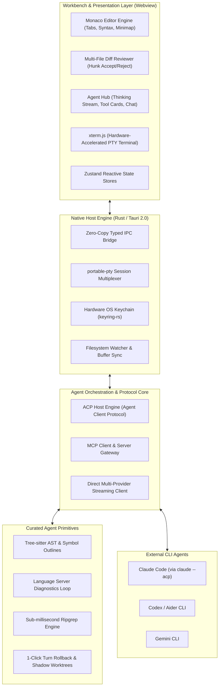

# 🦈 Shark Code

> **The Agent-First Code Editor** — Designed from the ground up for autonomous AI coding agents, universal CLI model hookups, and zero-compromise developer ergonomics.

## Backend foundation

Shark's workspace runtime joins native Rust editing, Graphify code exploration and dependency-impact reports, persisted tasks, and Google ADK sessions through one API. Task proposals carry their impact evidence; host application checks that the reviewed graph and edited source versions are still current.

Run `npm run backend:setup` once, then `npm run backend:dev` for the JSON-lines gateway. Set backend provider credentials and pass a configured model ID to `agent/start` for model execution. Tests use the real ADK runner and Graphify extractor with an offline model. See [the runtime guide](docs/backend/runtime.md) and [native tool reference](docs/backend/README.md) for setup, protocol examples, limits and remaining work.

## Current frontend preview

Run `npm install` and `npm run dev`, then open `http://localhost:1420`. `npm run build` checks TypeScript and produces the production bundle.

The conversation is the primary workspace. Create and search sessions (Ctrl/Cmd+K), describe work in the Build/Ask composer, and review the agent’s plan. Reviews open with a plain-language explanation, followed by optional syntax-highlighted Before/After code.

The Files tab includes an expandable project explorer, file filtering, new file creation, editor tabs, and a locally bundled Monaco editor with syntax highlighting, search, and Ctrl/Cmd+S. Unsaved files are marked, reloads warn about unsaved edits, and disk saves detect external changes. Use the header terminal button or Ctrl/Cmd+backtick to open the terminal.

- **Browser workspace:** starts with bundled project files. Saving persists edits in this browser. Open Folder connects a selected local folder in browsers that support the File System Access API; saving then writes to that folder. The browser console supports `help`, `pwd`, `ls`, `cd`, `cat`, `touch`, and `clear`.
- **Tauri desktop:** `npm run tauri dev` opens the native app. Workspace commands read and write local project files; Open Folder accepts a project path. The terminal runs an interactive system shell through portable-pty, with streamed output, keyboard input, resizing, and cleanup. Standard Rust/Tauri system prerequisites are required.

Agent conversations, activity, and proposals are still simulated and reset on reload. Accepting a sample records only a session approval; it does not apply that sample to disk. Model connections, real agent streaming, and agent-driven changes remain integration work. Manual file editing and saving operate independently of the sample agent.

---

## 💡 The Vision

Most modern code editors were built for a human typing line-by-line, with AI bolted on as an afterthought—trapped inside a tiny chat sidebar or basic autocomplete popup.

**Shark Code reverses this paradigm.** 

Shark Code is built **agent-first out of the box**. The editor serves as the agent's sensory nervous system and hands:
* **The agent can *see*:** Tracks active cursor coordinates, visible viewports, compiler diagnostics (LSP), and live web previews.
* **The agent can *explore*:** Navigates 500,000+ line codebases in under 20ms using native Ripgrep, Tree-sitter AST queries, and private local vector search.
* **The agent can *act safely*:** Streams multi-file proposed diffs directly into native review panes, executes commands in protected PTY sandboxes, and protects your work with 1-click Git checkpoint rollbacks.
* **CLI agents hook in natively:** External CLI powerhouses like **Claude Code**, **OpenAI Codex**, and **Gemini CLI** plug in via the open **Agent Client Protocol (ACP)** and **Model Context Protocol (MCP)** rather than being trapped in a terminal window.
* **100% BYOK & Private:** Bring Your Own Key (Anthropic, Gemini, OpenAI, Ollama/Local) with direct client-side API streaming and hardware-backed OS Keychain encryption. No middleman servers, no data logging.

---

## 🏛️ System Architecture



---

## ⚡ Core Features

### 1. 👁️ Sensory Perception ("See & View")
* **Attention Tracking:** Continuously streams the active file, cursor position, selection, and open buffers into the agent's prompt context automatically.
* **LSP Compiler Loop:** The agent listens to real-time TypeScript, Rust, or Python compiler diagnostics to automatically heal type errors and syntax mistakes.
* **Live Web Preview:** Embedded secondary Webview capturing DOM snapshots, console logs, and visual screenshots for full-stack feedback.

### 2. 🔍 High-Velocity Exploration ("Fetch & Explore")
* **Sub-Millisecond Ripgrep:** Rust-powered regex search (`grep-searcher` + `ignore`) that scans whole repositories in <20ms while respecting `.gitignore`.
* **Tree-sitter AST Outlines:** Instead of dumping thousands of lines into context, the agent requests structural skeletons of files (functions, classes, interfaces).
* **Local Semantic Search:** Embedded vector search powered by CPU-friendly ONNX embeddings (`fastembed-rs` + `sqlite-vec`), enabling natural language search with zero API costs.

### 3. 🛡️ Surgical Execution & Safety ("Act & Verify")
* **Streaming Ghost Diffs:** Code proposals stream live into the editor with hunk alignment and single-click *Accept & Apply* or *Reject* controls.
* **1-Click Checkpoint Rollbacks:** Automatically snapshots a commit-less Git reflog before every agent turn. If an agent goes down the wrong path, undo the entire turn in 50ms.
* **Shadow Git Worktrees:** Long-running refactors run in isolated `.shark/worktrees` without disturbing your dirty working tree.
* **Protected PTY Terminal:** Interactive `portable-pty` shell with permission shields for destructive terminal operations (`rm`, `git reset`).

### 4. 🔌 Universal CLI Model Hookup (ACP & MCP)
* **Agent Client Protocol (ACP) Host:** Zed & Anthropic's open protocol standard. Hook external CLI tools like **Claude Code** (`claude --acp`) over stdio to render native diffs and task trees.
* **Model Context Protocol (MCP) Hub:** Exposes Shark Code's AST and diagnostics as an MCP server to external tools, and consumes external MCP tool plugins configured by the user.

### 5. 🔑 100% BYOK (Bring Your Own Key)
* Direct connections to:
  * **Anthropic** (Claude 3.7 Sonnet with extended thinking, Claude 3.5 Sonnet / Haiku)
  * **Google Gemini** (Gemini 2.5 Pro / Flash with 1M+ context windows)
  * **OpenAI** (GPT-4o, o3-mini, Codex)
  * **Ollama & Local LLMs** (DeepSeek R1, Llama 3, Qwen)
* Encrypted via hardware OS Keychain (SecretService / GNOME Keyring / macOS Keychain / Windows Credential Manager).
* Zero third-party proxy servers.

---

## 🛠️ Tech Stack

| Layer | Technology | Purpose |
| :--- | :--- | :--- |
| **Desktop Shell** | [Tauri 2.0](https://tauri.app/) | Ultra-lightweight native runner (~80MB RAM, 25MB binary) |
| **Native Core (Rust)** | Rust 2024 Edition | High-performance PTY, search, AST, and ACP protocol handling |
| **Terminal Engine** | [`portable-pty`](https://crates.io/crates/portable-pty) + [`@xterm/xterm`](https://xtermjs.org/) | True VT100/Xterm PTY emulation with WebGL hardware acceleration |
| **Key Management** | [`keyring-rs`](https://crates.io/crates/keyring) | Hardware-backed OS credential storage |
| **Search Engine** | [`ignore`](https://crates.io/crates/ignore) + [`regex`](https://crates.io/crates/regex) | Ripgrep-grade workspace indexing |
| **Frontend Framework** | [React 19](https://react.dev/) + [Vite](https://vite.dev/) | Blazing fast reactive UI layer |
| **Code Editor** | [Monaco Editor](https://microsoft.github.io/monaco-editor/) | Authentic VS Code editing, IntelliSense, and Diff view |
| **Styling & Icons** | [Tailwind CSS v4](https://tailwindcss.com/) + [Lucide](https://lucide.dev/) | Clean, modern developer workbench aesthetics |
| **State Management** | [Zustand](https://github.com/pmndrs/zustand) | Fast reactive state stores for editor, agent, and workspace |

---

## 📂 Project Structure

```
shark-code/
├── src-tauri/                 # Native Rust Backend (Tauri 2.0)
│   ├── src/
│   │   ├── main.rs            # Desktop application entry point
│   │   └── lib.rs             # Tauri command handlers & plugin registration
│   ├── Cargo.toml             # Rust dependencies (portable-pty, keyring, ignore)
│   └── tauri.conf.json        # Window configuration and app permissions
│
├── src/                       # Frontend Workbench (React 19 + TypeScript)
│   ├── components/
│   │   ├── agent/             # Agent hub, thinking blocks, model picker
│   │   ├── editor/            # Monaco editor & multi-file diff reviewer
│   │   ├── layout/            # Activity bar & status bar
│   │   ├── sidebar/           # File explorer, Ripgrep search, BYOK settings
│   │   └── terminal/          # xterm.js PTY terminal emulator
│   ├── stores/                # Zustand stores (useEditorStore, useAgentStore, etc.)
│   ├── types/                 # Shared TypeScript models & interfaces
│   ├── App.tsx                # Main IDE layout assembler
│   └── main.tsx               # DOM root mount
│
├── package.json               # Frontend dependencies & scripts
├── tsconfig.json              # TypeScript strict configuration
└── vite.config.ts             # Vite build configuration & path aliases
```

---

## 🚀 Getting Started

### Prerequisites
* **Node.js**: v20+ (tested with v24.x)
* **Rust & Cargo**: 1.80+ (tested with 1.98.x)
* **System Libraries (Linux)**: `webkit2gtk-4.1`, `gtk-3`, `libsoup-3.0` (standard on Fedora, Ubuntu, Arch)

### Installation
```bash
# Clone the repository
git clone https://github.com/your-username/shark-code.git
cd "shark code"

# Install frontend dependencies
npm install
```

### Running the App
* **Web UI Development Preview (fast browser iteration):**
  ```bash
  npm run dev
  ```
* **Full Native Desktop Application (Tauri + Webview):**
  ```bash
  npm run tauri dev
  ```

---

## 🗺️ Roadmap

- [x] **Phase 1: Foundations** — Tauri 2.0 + React 19 + Monaco Editor + xterm.js + BYOK settings.
- [ ] **Phase 2: Native Curated Tools** — Ripgrep workspace search, Tree-sitter AST queries, and live buffer diff streaming.
- [ ] **Phase 3: ACP & Claude Code Link** — Full Agent Client Protocol host integration over stdio for `claude --acp`.
- [ ] **Phase 4: Worktree Sandboxing** — Git checkpoint turn rollback and isolated `.shark/worktrees`.
- [ ] **Phase 5: Self-Healing LSP Diagnostics** — Closed-loop error feedback directly into agent prompt turns.

---

## 📄 License

MIT © Subhradeep
