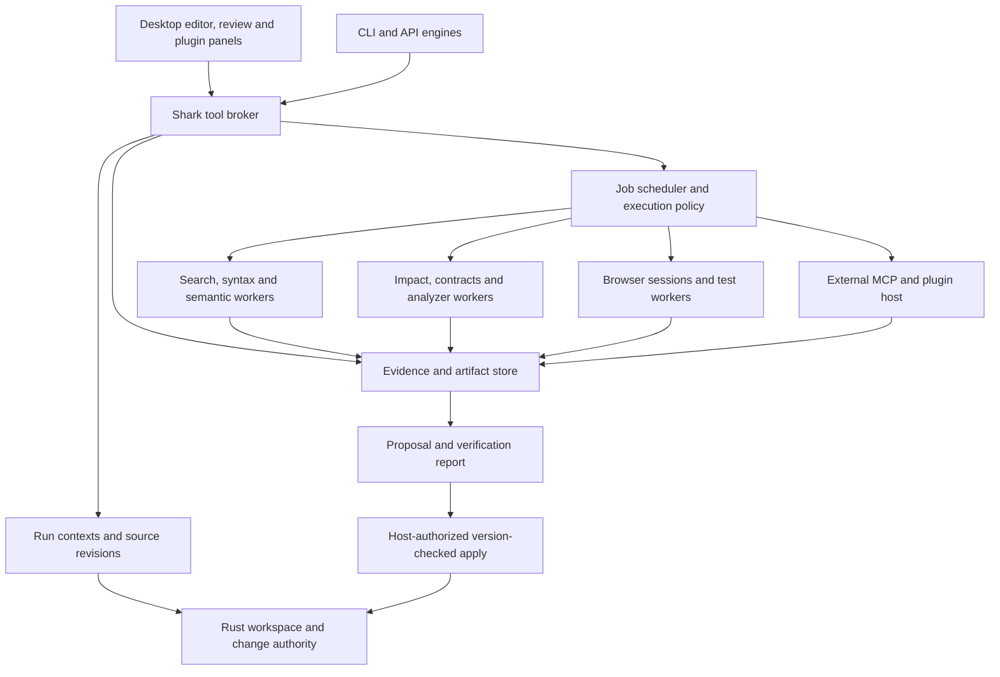

# A coherent agent-first architecture for Shark

Status: architecture proposal with the first core implementation in progress. Date: 2026-11-06.

The later product requirement supersedes the optional-pack recommendation below: the requested ten-category capability set must ship as core functionality. See [current capability status](core-capability-status.md) for what is implemented and what remains. External enterprise services may stay optional; they cannot substitute for promised core capabilities.

User constraints: research and architecture first; local-first, open-source core; optional cloud services. The [research report](code-intelligence-research.md) compares the tools and links to primary sources. This document proposes how they should work together inside the existing product.

Shark should own the workspace version, tool execution, evidence and change lifecycle. Engines and plugins should access these services through one broker. A user should be able to ask for a change and receive a proposal showing what changed, what could be affected, what was actually checked and what remains unknown.

## Findings from the current project

| Area | Present implementation | Architectural gap |
| --- | --- | --- |
| File authority | Rust core provides confined access, versioned edits, journals and recovery. `crates/shark-core/` | Preserve this boundary for applying changes; provider-owned editing must become proposals. |
| Tasks and engines | Python service, SQLite task/events, API agents and isolated CLI copies. `backend/shark_runtime/service.py`, `store.py`, `agent.py`, `cli_agents.py` | A task needs a managed execution context and revision identity shared across every engine and tool. |
| Graph | Pinned Graphify AST worker, snapshot-derived index, query and reverse-dependency impact. `graph.py`, `graph_worker.py` | One structural provider is insufficient for precise semantic references, contracts and runtime evidence. Current confidence labels do not establish compiler resolution. |
| Analysis | `tools/detect` and `tools/analyze`, including built-in checks and optional CLI adapters. `intelligence.py` | Tools analyze the main workspace; external output is mostly raw text. They need task context, normalized findings and durable artifacts. |
| Browser | Local preview proxy, source-line ranking and one-shot Playwright check. `browser.py` | No shared interactive task session, verification plan or durable trace identity. `check` accepts a URL without the local-target check used by `serve`; policy should be centralized. |
| Language servers | Python/Rust/Go/C-family servers for editor requests; TypeScript primarily in Monaco. `lsp.py`, `src/components/workbench/lsp.ts` | Agents need backend semantic tools. Editor buffers and candidate files require distinct versioned server views. |
| MCP | Outbound Shark MCP server over a token-protected local bridge with a method allowlist. `mcp_server.py`, `bridge.py` | There is no general incoming external-provider host, per-run capability grant or shared artifact contract. |
| Plugins | Project HTML panels in sandboxed iframes, declared permissions and a UI message bridge. `src/components/workbench/plugins.tsx` | These are UI extensions, not a backend agent-tool/plugin system. Declared permissions must be distinguished from granted permissions. |
| Distribution | Rust/Python sidecars; optional analyzer binaries and browser installation. `scripts/build-sidecars.sh` | A built-in experience requires pinned tool packs, health checks, provenance and update/rollback behavior. |

The most urgent correctness issue is source identity: CLI engines edit a disposable copy while their Shark MCP tools query the original Service. An impact result can describe the base project while a browser or test describes another version. Fix that before adding more analyzers.

A private copy is also not a process sandbox. Current dependency symlinks can point back to writable installed packages. The proposed execution service must state its actual isolation level and protect shared dependencies where supported.

## System layout



Keep the desktop as a client, Rust as the source/edit authority, and Python as the orchestration layer. Use subprocess workers for heavyweight parsing, analysis, browsers and external MCP connections. Avoid moving the entire application into a new framework or requiring a graph server for a single local project.

## 1. Source and run contexts

Introduce `RunContext` as a first-class object. It identifies workspace, task, engine run, base revision, candidate generation, managed root, environment and capability grants. A Git commit alone is insufficient because a workspace can contain dirty or untracked source, or have no Git repository.

Use immutable manifest digests built from the included path/content hashes and inclusion-policy version. Record configuration, lockfile and toolchain identities separately. The initial snapshot can reuse Rust's existing snapshot/artifact machinery. Manifests must describe omitted files and unsupported inputs.

Distinguish four views:

| View | Meaning |
| --- | --- |
| Working | Current user files on disk. |
| Editor | An explicitly identified set of unsaved buffer versions layered over disk. |
| Base | Immutable source captured for a task. |
| Candidate | Managed base plus the engine's current proposed edits. |

Agents default to their own candidate; pre-change exploration can explicitly query base. Interactive editor navigation uses the editor view. A browser/test job must identify which candidate generation it launches. Do not share a mutable language-server document state between independent views.

The broker derives authorized context from the caller's run token. An agent cannot select another task's root by passing an arbitrary filesystem path. External providers receive translated paths for their assigned managed root.

On every CLI write, advance candidate generation and invalidate affected derived results. At validation boundaries, freeze a candidate manifest and reconcile filesystem events against actual content hashes. A watcher is a scheduling hint, not source authority. Long-lived language servers must acknowledge synchronization before their results are used for that generation.

At proposal creation, compare candidate to the captured base. If the user's working source changed during the run, show a conflict/rebase decision rather than interpreting those user edits as engine deletions or silently rebasing them. Retain the existing expected-version apply checks.

## 2. One tool broker and result contract

Replace the growing set of separate frontend, MCP and API tool definitions with a registry consumed by each adapter. Generate compatible schemas and documentation from the same descriptors; use adapter wrappers where a model cannot consume the full schema.

Each descriptor includes provider/version, input/output schema, supported languages/views, read/propose/execute/network effects, required grants, cost class, cancellation support, time/output limits, configuration identity and health. Built-in and external tools implement the same interface.

Separate installation, health, authorization and execution state. A tool can be installed but broken, healthy but not granted, running, degraded or unsupported for this language. “Available” alone is insufficient.

Example internal invocation:

```json
{
  "tool": "change.analyze",
  "context_id": "run-context-17",
  "input": {"base_revision": "base-hash", "candidate_revision": "candidate-hash"},
  "budget": {"deadline_ms": 30000, "max_result_bytes": 24000}
}
```

Example result envelope, with illustrative IDs:

```json
{
  "status": "partial",
  "context_id": "run-context-17",
  "revision": "candidate-hash",
  "provider": {"id": "typescript-semantic", "version": "pinned-version"},
  "provenance": {"tool_config_digest": "config-hash", "environment_digest": "env-hash"},
  "coverage": {"files_examined": 25, "files_skipped": 2, "unknown_references": 3},
  "summary": "Two resolved callers and one unresolved dynamic call need review.",
  "evidence": [{"kind": "resolved_reference", "path": "src/client.ts", "symbol_id": "symbol-42"}],
  "artifacts": [{"uri": "shark-artifact:report-123", "media_type": "application/json"}],
  "next_cursor": null
}
```

Normalize internal ranges as UTF-8 byte offsets with explicit line mapping. Translate LSP UTF-16 positions and tool-specific line/column conventions at adapters. Validate source hashes before presenting ranges as current.

Preserve full analyzer output as an artifact. Return bounded structured findings with pagination; avoid truncating a JSON string into an unusable result. Failure, timeout, unsupported, cancelled, stale and partial must be distinct. An exit code alone does not mean a successful analysis or a passing check.

## 3. Exploration and intelligence storage

Use SQLite initially for metadata, relations, jobs and evidence, plus content-addressed files for large artifacts. Add FTS5-ranked symbol/document/source chunks. Start without mandatory embeddings, a vector service or Neo4j. This is an engineering recommendation; measure the workload before changing storage.

Proposed entities: workspaces, manifests, files, symbols, symbol aliases, relations, provider snapshots, findings, checks, runs, artifacts, grants and plugin installations. Relations carry source/target identities, provider, source revision, source ranges and resolution kind.

Use language-qualified identities, including package/module/signature information where available. Treat cross-revision rename matching as an explicit mapping with evidence. SCIP IDs can be retained as provider identities; they are not automatically identical to IDs from every language server.

Keep several kinds of evidence distinct:

| Evidence | Permitted interpretation |
| --- | --- |
| Compiler/server resolved reference | The provider resolved this reference under the recorded configuration. |
| Syntactic import/call | This source construct exists; its runtime target may remain unresolved. |
| Framework/configuration link | An adapter found a route, selector, command, schema or resource connection. |
| Runtime observation | This recorded execution used the connection; other paths may exist. |
| Historical co-change | Files changed together in the selected history window. |
| Semantic similarity or model inference | A retrieval/review suggestion, not an established dependency. |

Do not turn those labels into unsupported numeric probabilities. Store disagreements and ambiguity instead of silently upgrading the weaker provider's result. An “extracted” AST call still requires resolution before it can be called a precise reference.

Exploration should combine name/path search, ranked text, structural matches and graph neighborhoods. Follow discovered identifiers through semantic tools. Optional embeddings retrieve candidates, while graph/semantic evidence answers relationship questions. Return compact evidence paths and the next useful source ranges rather than whole-repository context dumps.

Index source deltas incrementally. Invalidate reverse dependencies when exports, configuration or generated contracts change. Keep a rebuild path for corruption or incompatible schema versions. Schedule an immediate useful fallback while large indexes warm up.

## 4. Blast radius and deep change analysis

Use a deterministic pipeline that compares base and candidate:

1. Classify files and changed symbols, including additions, deletions, signatures, exports, configuration and dependencies.
2. Compare syntax and available semantic/API surfaces. Present structural differences separately from behavioral hypotheses.
3. Traverse reverse dependencies in the union of relevant base and candidate graphs. Base edges are necessary to find callers of deleted or disconnected symbols.
4. Expand through applicable contracts: HTTP routes/OpenAPI, IPC/RPC method names, events, database schemas, build inputs, HTML script/style references and frontend/backend boundaries.
5. Add separately labeled historical co-change and runtime evidence. Bound depth and report frontier truncation and unresolved edges.
6. Select checks/tests using dependency reachability, package configuration and recorded coverage, then run them on the frozen candidate.
7. Compare baseline and candidate diagnostics under matched tool/configuration/environment identities.
8. Produce a change report with explained impact, added/removed findings, validation evidence, conflicts and unknowns.

Define edges consistently as dependent → dependency. Reverse traversal finds callers/consumers; forward traversal finds requirements. A detected dependency cycle is not a reason to expand to the whole repository without explaining the bounded frontier.

A useful report answers: which public surfaces changed, which consumers are known, which resources/contracts may be affected, which tests were selected and why, what actually failed, and where analysis coverage is missing. Separate existing failures from new regressions. Unsupported languages or unavailable analyzers produce unknown coverage, not a green result.

For Shark specifically, prioritize typed links across the TypeScript request wrapper, Tauri commands, Python method dispatch and Rust protocol. Also add the currently missing HTML `<script src>` connection. Name matching can seed these links, but ambiguous dispatch/configuration connections must remain labeled heuristic until verified.

Tests selected from static impact or old coverage are a recommendation, not proof that all affected behavior is covered. Use broader validation for shared configuration, dependency updates and unresolved dynamic boundaries. Keep configurable review policy separate from an opaque “risk score.”

## 5. Browser and verification service

Expand the existing Playwright integration into a broker-managed session service. Default to Shark's existing Python Playwright runtime to avoid requiring Node for every desktop install. Offer official Playwright MCP as an interchangeable external provider, and Chrome DevTools MCP as an optional advanced diagnostics provider. Their documented strengths and limitations are covered in the research report.

A session owns context/run identity, candidate generation, browser version, viewport, profile, dev-server process and artifacts. Default to isolated storage per task. Users can explicitly select an authenticated profile when a workflow needs it; do not inherit personal browser state automatically.

Capabilities should include open/navigate, accessibility snapshot, locate/click/fill/key actions, assertions, screenshot, console/network inspection, tracing and close. Use semantic locators or revision-tagged snapshot references. Expired references require a fresh snapshot. General page/host code evaluation is an elevated execution capability, not part of simple read-only page inspection.

Launch the candidate dev server through the same job service as tests. Register its origin, PID/process group, command, build/input digest and readiness condition. Reuse a server only if its identity and source generation match. Distinguish source-served development pages from built bundles and record how the checked build was produced.

Apply destination policy to navigation, redirects, subresources, WebSockets and downloads, with explicit allowances for configured local APIs. Treat remote browsing as a separate optional capability. Cancellation closes contexts and child processes. Use explicit readiness/assertions rather than assuming network idle works for applications with polling or sockets.

Persist traces, screenshots, action transcripts, console/network results and assertion outcomes as task artifacts. A “page loaded” result is different from “checkout completed.” Accessibility checks cover automated findings only. Source-map stacks and framework instrumentation can improve DOM-to-source navigation; the current text/class ranking remains a heuristic fallback.

The embedded desktop preview and headless browser have different sessions. Make the selected target visible. Sharing cookies/session state requires an explicit transfer mechanism; showing the same URL does not mean both browsers see the same state.

## 6. Plugins, skills and external MCP

Create a Shark plugin manifest with independently declared components: UI panel, instruction skills, tool provider, analysis adapter and optional lifecycle hooks. A plugin can package several, but each retains its own permissions and version compatibility.

The backend plugin host discovers external MCP tools, maps names into provider namespaces, validates schemas and invokes them through the broker. The outgoing Shark MCP server exposes the same granted capabilities to CLI engines. Do not let provider descriptors or remote tool annotations grant themselves authority. MCP is the transport; Shark owns context, policy and evidence.

Installation records should identify exact version/source digest, component versions, required runtimes, license metadata, granted scopes and configuration. Preserve updates and rollback. Avoid launching `npx --yes ...@latest` during a tool call or copying arbitrary engine-global plugins into Shark.

Provide an explicit import flow for existing MCP configurations and skills. Show conflicts and unsupported vendor hooks, resolve credentials through the OS secret store and store secret references rather than tokens in shared manifests. An imported skill is instruction text; tool availability is checked independently.

Useful scopes include code read, candidate edit/propose, task execution, browser actions, local/remote network and external writes. Prefer durable workspace/profile grants for routine authorized work over repeated prompts. Existing terminal execution remains an execution capability. UI panels call the broker through the host bridge; frontend-only checks cannot authorize backend tool execution.

Skills and retrieved documents can guide reasoning but cannot expand grants. Providers that only edit files must operate in the candidate context so changes can be diffed into a proposal. Providers that cannot be constrained to that context are incompatible with the default review workflow.

External CLI engines may have their own shell/tools. Routing Shark tools through a broker does not control those independent capabilities. Advertise the actual isolation profile and use OS/container enforcement where required; do not claim a broker alone prevents filesystem or network access.

## 7. Execution, scheduling and memory

Use a cancellable job DAG with priorities: interactive reads/navigation, task-critical checks, incremental indexing, then optional deep analysis. Deduplicate identical derivations by input digest. Schedule expensive analyzers on demand; do not start every provider on workspace open.

Track process groups or platform job objects, enforce CPU/memory/disk/output/deadline budgets where supported, and clean child processes after cancellation or restart. Separate immutable source-analysis inputs from buildable execution roots. Project compilers, test runners, build scripts and executable configurations can run code; workers need an execution policy appropriate to that fact.

Keep SQLite task/event storage and add structured job/evidence records. Agent sessions reference artifact IDs. Retained summaries cite their source revisions and are invalidated when evidence changes. A summary of a previous run is not current ground truth. Add artifact retention, disk quotas, pinning for open proposals and garbage collection; source snapshots and browser traces can be large.

Parallel agents share an immutable base and read-only derivations. Each owns a candidate generation. Combine results as proposals with conflict detection; do not let agents write a shared candidate concurrently without explicit coordination. Record provider/tool events uniformly so the user can inspect how each engine reached its result.

## 8. Packaging a built-in experience

Ship the native core, runtime, registry, syntax extraction, local ranked retrieval, graph adapter and built-in analysis without a cloud dependency. Add a tested browser pack with an OS-matched Chromium revision and a documented browser update mechanism. Whether it is in the main download or a separately cached pack is a distribution decision, not a change in the tool API.

Ship optional, versioned language packs for semantic servers and common checks. A pack describes platform/architecture, binaries, schemas, grammars, rules, notices, integrity/provenance information and dependency compatibility. Support offline installation from a downloaded pack. Avoid system-wide package installation as Shark's default setup path.

Keep heavyweight Joern/CodeQL analysis and remote services optional. Distribution rights vary by component and release; the research report identifies current restrictions affecting GitNexus, Serena and CodeQL. Verify exact artifacts before selecting a bundled version. Disable optional telemetry and remote rule/model downloads in the local-first profile.

“Built in” should mean that the capability has a supported lifecycle, health reporting, consistent results and appropriate packaging. Merely adding a command name to a detection list does not provide that experience.

## 9. Migration plan and acceptance gates

| Phase | Concrete work | Gate before proceeding |
| --- | --- | --- |
| 1. Correct source identity | RunContext, frozen base/candidate manifests, scoped tokens, candidate-root routing and evidence envelope. Preserve existing adapters. | Modify only a CLI candidate and prove search, graph, syntax analysis and checks see that candidate. Reject cross-run access. Detect user edits since base capture. |
| 2. Shared broker | Tool registry, normalized findings, artifacts, job cancellation and health. Generate MCP/API/desktop schemas. | All three clients receive equivalent results for the same invocation; full output remains retrievable after pagination. |
| 3. Semantic navigation | Backend TypeScript provider; expose current language servers to agents; synchronize views and translate edit coordinates. Compare SolidLSP/multilspy using fixtures. | Correct definitions/references with aliases, overloads and Unicode; rename stays a versioned proposal. Unsupported capabilities are explicit. |
| 4. Browser verification | Candidate server lifecycle, task-scoped Playwright sessions/actions/assertions/traces. | A proposal's browser evidence proves which candidate/build it inspected; concurrent tasks cannot share session state accidentally. |
| 5. Deep change reports | Base/candidate graph comparison, contract adapters, diagnostic deltas, test selection and history signals. | Detect deleted-symbol consumers and configured cross-language boundaries; expose unresolved dynamic edges and stale coverage. |
| 6. Plugin host and packs | Incoming MCP, components/skills import, grants, pinned packs and update/rollback. | A broken plugin degrades independently; imported tools cannot bypass context or application boundaries; offline installation works. |
| 7. Advanced providers | Optional SCIP, Joern, CodeQL, remote search and embeddings. | Demonstrated quality gain on measured tasks with acceptable install size, resource use and rights. |

Do not attach calendar estimates before a short phase-1 spike measures the required migration. Deliver each phase as a reviewable slice. The current runtime version/capability handshake should advertise new context-bound APIs before clients rely on them.

## Proposed code boundaries

These are target modules for later implementation, not files added in this research phase.

| Boundary | Proposed location | Responsibility |
| --- | --- | --- |
| Run and revision management | `backend/shark_runtime/contexts.py` | Managed roots, manifests, generations and caller bindings. |
| Shared tool definitions | `backend/shark_runtime/tools/registry.py` | Schemas, capability discovery, grants and adapter dispatch. |
| Jobs and workers | `backend/shark_runtime/jobs.py` | Scheduling, cancellation, process ownership and resource budgets. |
| Evidence and artifacts | `backend/shark_runtime/evidence.py` | Structured results, provenance, pagination and retention using the existing Store. |
| Intelligence providers | `backend/shark_runtime/providers/` | Graphify, semantic servers, SCIP and external analyzers behind provider interfaces. |
| Browser sessions | `backend/shark_runtime/browser_sessions.py` | Candidate server/browser lifecycle and verification evidence. |
| External extensions | `backend/shark_runtime/plugin_host.py` | Incoming MCP, component discovery, scoped credentials and lifecycle. |
| Change reports | `backend/shark_runtime/change_analysis.py` | Base/candidate comparison, impact, contracts and validation plans. |

Keep `service.py` as a compatibility facade during migration. Route `agent.py`,
`mcp_server.py` and the desktop API to registry operations instead of independently
reimplementing them. Reuse the existing core, task events and journals rather than
creating competing stores or edit paths. Split modules only as implemented behavior
requires them; these boundaries describe ownership, not a mandate to create empty scaffolding.

## 10. Evaluation and release criteria

Build fixtures for TypeScript, Python, Rust, Go and C/C++, plus mixed frontend/backend projects. Include dirty/untracked files, no-Git projects, Unicode identifiers, aliases, overloads, dynamic dispatch, decorators, generated code, deleted symbols, HTML resources, IPC strings, API/schema changes and separate concurrent candidates.

Measure retrieval recall at a fixed context budget, reference/impact precision and recall against known fixture relationships, unknown/unsupported coverage, index warm-up and refresh latency, query/check latency, peak memory, disk usage, cancellation cleanup and installation size. Include thousands to tens of thousands of files as fixture tiers, subject to explicitly raised native limits; the current 20,000-file bound is not silently lifted by this proposal.

Use identical tasks/models/budgets to compare text-only, syntax/graph, semantic and runtime-assisted exploration. Measure correctness and regressions before token savings. Benchmark fresh and stale indexes separately. Results from one graph provider's marketing page are not Shark benchmarks.

Release gates include no falsely current evidence after candidate changes, explicit partial/error states, working cancellation, recoverable apply, offline core operation, and packaged-build verification on each supported OS. Product UI should show the affected code, check outcomes and missing coverage in the existing task/review flow; a separate wall of tool names would leave the coherence problem unsolved.

The recommended first implementation is phase 1: bind every tool and verification result to the engine's candidate revision. That gives every later tool a reliable place in Shark's change workflow.
