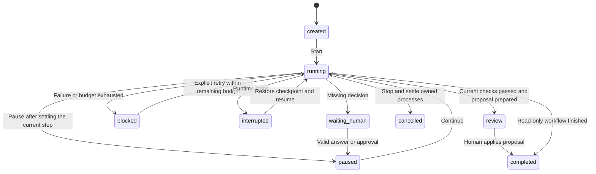

# Durable Shark orchestration

Shark runs autonomous work in a persistent private source copy. It asks for missing
human decisions and leaves the final source proposal for host approval. This is the
user-selected default. A node canvas is not implemented; the versioned DAG below is
the execution model a future canvas could display and edit.

## What ships

- A SQLite-backed step graph with validated IDs, dependencies, bounded definitions and cycle rejection.
- Four node kinds: agent, read-only intelligence, validation command and human checkpoint.
- Source checkpoints before execution, durable results, pause/resume, cancellation and restart recovery.
- Serial mutations per candidate; up to four independent workflows can run concurrently.
- Bounded transient network/rate-limit retries with rollback. Authentication, quota, validation and unknown failures stop for attention.
- Optional bounded debugger repairs when validation fails.
- Active-time, agent-run and attempt budgets. Human waiting and paused time are excluded from active time.
- Final source review and version-checked apply through the existing proposal system.
- Conversation controls for step progress, questions, approvals, pause, continue, retry and stop.

Builder, Debugger, Test writer and Refactor runs default to the multi-step workflow
option in the mode menu. Read-only modes retain the existing single-run behavior.
The default plan gathers context, invokes the selected engine, collects quality
evidence and runs discovered npm test scripts. Discovery prefers `test:ci`, `test`,
then `backend:test`, skips explicit watch scripts and records the exact command.
Other languages or custom validators use explicit check nodes. If no check is
configured/discovered, the final review says so; analysis is not represented as a
passing test. API keys are supplied at start/resume and are never serialized in plans.

## Lifecycle



Human gate IDs are single-use and bound to the candidate's source content. An answer
is distinct from permission to act. A model cannot supply its own approval, start
arbitrary workflows through MCP or approve final source application. Runtime
questions park the current invocation; it is replayed from a source checkpoint with
the answer in its bounded context. A rejection blocks progress.

Completed nodes are not replayed on ordinary resume. An uncertain interrupted node
is restored to its pre-attempt checkpoint before explicit retry. Source changes in
the real project prevent final proposal creation. Plan edits require an optimistic
version match, an inactive workflow and unchanged completed nodes.

## Validation and evidence

Commands are argument arrays with no implicit shell. They run in the candidate with
bounded returned output, an output-spool guard, deadlines, a minimal environment and
`CI=1`. Python checks receive fresh cache paths so same-size repairs cannot reuse a
stale bytecode file. Source writes by validation fail the step and are rolled back.
Git discovery is bounded so a candidate does not accidentally discover its ancestor
repository. Candidate service Git mutations are disabled.

A passing check records a source-content digest. If a later step or repair changes
source, required checks are invalidated and rerun before review. Quality/security/
dependency/architecture intelligence can likewise require current source. Initial
context is allowed to remain a labeled historical input. Repairs and refreshes consume
the same workflow budgets; there is no unbounded repair loop. Analysis coverage limits
remain attached to reports and do not become test passes.

Candidate reports and immutable source artifacts are retained in the original task's
workspace. Prior step summaries, artifact IDs and human answers are packaged into a
bounded brief for later engine invocations. Final review notes report the configured
validation count and identify the candidate revision.

## API

Runtime capability version: **6**. The definition schema is `shark-workflow-v1`.

| Method | Inputs |
| --- | --- |
| `workflow/create` | `goal`, optional `steps`, `run`, `budget`, `checks` |
| `workflow/get` | `id`, optional step `offset` and `limit` |
| `workflow/step` | `id`, `step_id` for detailed evidence |
| `workflow/start` | `id`, optional transient `api_key` |
| `workflow/pause`, `workflow/cancel` | `id` |
| `workflow/resume` | `id`, optional `api_key`, explicit `retry_failed` |
| `workflow/respond` | `id`, `gate_id`, `decision`, optional `answer` |
| `workflow/replan` | `id`, `expected_version`, `steps` |
| `workflow/ask` | Bound engine-only question; no caller-selected workflow ID |

Only `workflow/ask` is exposed through the agent bridge. API engines receive
`request_human_input`; CLI engines receive `shark_request_input`. Host-only lifecycle
methods are available to the desktop API through `sharkWorkflows`.

A custom node can use these shapes, with dependency arrays referring to node IDs:

```json
[
  {"id":"inspect","kind":"intelligence","operation":"structure"},
  {"id":"build","kind":"agent","depends_on":["inspect"],"goal":"Implement the requested change"},
  {"id":"verify","kind":"check","depends_on":["build"],"argv":["npm","test"],"repair_attempts":1},
  {"id":"decision","kind":"human","depends_on":["verify"],"question":"Proceed with the proposed behavior?","gate_kind":"approval"}
]
```

## Execution limits

This is a local durable coding workflow, not a distributed workflow service or an
OS process sandbox. Project commands and CLI engines can have effects outside their
working directory; source rollback cannot reverse external effects. Generic external
automation connectors and their permission model remain future work. The current
host exposes no generic model-controlled external write node.

Cancellation kills owned POSIX process groups, including children left after a parent
exits. Windows currently stops the direct process and still needs full Job Object
coverage. Non-cancellable source-analysis calls settle before rollback; a deadline
invalidates a late result but cannot forcibly interrupt every in-process library.
Workspace authorities remain open while an in-flight agent tool is still settling.

Restart recovery is explicit rather than silently replaying uncertain work. Invocation
budgets bound engine starts, not exact token expenditure inside every third-party CLI.
Checkpoints are retained under `.shark/workflows`; automated retention/garbage
collection and filesystem quotas are not yet implemented. A local runtime must stay
running for autonomous progress; this does not schedule work while the computer is off.

The design accounts for the documented possibility of tool re-execution during
resumption instead of claiming exactly-once external effects. See
[ADK resumption behavior](https://github.com/google/adk-docs/blob/main/docs/runtime/resume.md)
and [Temporal retry/idempotence guidance](https://docs.temporal.io/encyclopedia/retry-policies).

## Verification checkpoint

On 2026-11-06, all 86 backend tests and the frontend production build passed.
Browser interaction checks exercised answering, automatic resume, pause, continue and
stop; rendered light/dark states were inspected. The Linux frozen runtime matched all
29 source modules and passed its grammar, SQLite, MCP and Chromium component checks.
A packaged workflow smoke test passed a human gate/resume cycle and a real fixture CLI
implementation/validation/review/apply cycle. Original source remained unchanged until
the explicit host apply call. No live provider quota was used for these fixtures.
