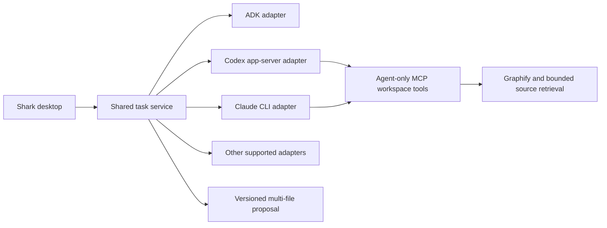

# CLI-agent integration direction

Status (November 6, 2026): **implemented** for Claude Code (`claude -p --output-format stream-json`), Codex (`codex exec --json`), Antigravity (`agy -p --output-format stream-json --mode accept-edits`) and Muse (`muse exec --json`) in `backend/shark_runtime/cli_agents.py`. API engines: Gemini and Anthropic (ADK native) and OpenRouter (ADK `LiteLlm`, `openrouter/<model>`). `effort` maps to `--effort` (Claude, agy), `--reasoning-effort` (Muse), `-c model_reasoning_effort` (Codex) and the provider thinking config for API engines. Engines emit `thinking`/`thinking_delta`, `tool_call`/`tool_result` and `text`/`text_delta` events. Binaries are also searched in common user install directories because desktop launches get a minimal PATH. `agent/models` returns `agy models`, Claude aliases or the live OpenRouter tool-capable catalogue. `scripts/engine-playground.py` runs live engines against a throwaway project. Each run copies the workspace to a temporary directory, streams the CLI's JSON events into the task log, then imports the copy's file differences as a normal versioned proposal (`task/propose`). Nothing reaches the real workspace until the person applies it. `agent/providers` reports availability; `agent/commands` lists Claude Code custom slash commands (passed through natively) and Codex prompts (expanded into the prompt). Tests use fake CLI binaries; no live CLI/model call was made.

Limits: the copy excludes `.git`, `node_modules`, build outputs and symlinks, so CLIs cannot run builds that need installed dependencies inside it. A copy is not a process sandbox; the CLI's own permission mode (Claude `acceptEdits`, Codex `workspace-write`) still governs what else it can touch. The MCP bridge below is still pending.

Original research notes follow.

Shark should own the UI, task/event records, workspace versions, proposal review and application. A provider-neutral adapter owns each agent's process/transport and session identity. ADK remains one runtime option, rather than wrapping every other agent's reasoning loop inside ADK.

The adapter contract needs discovery, supported-model catalog, authentication status, start, resume/send, events, interrupt/cancel and close. Store the provider's session/thread ID with the Shark task. Translate events into text deltas, completed messages, tool activity, approval requests, usage and final/error states. Cap outputs and avoid raw stdout/ANSI scraping when a structured protocol exists.

First implementation: Codex app-server, which is explicitly designed for persistent conversations, event streaming and approval handling in a product-owned UI. Second: Claude Code's supported programmatic interface, with streamed JSON and session resumption. Native CLI authentication and supported model selection should be preserved; do not extract credential files or treat consumer sign-in as a generic API key. Authentication behavior must be verified for the exact selected invocation mode (for example Claude's bare mode uses API/provider credentials rather than subscription login).

Expose the existing bounded exploration/impact/proposal operations through an actual MCP adapter. The current Shark JSON-lines protocol is not MCP. Graphify remains agent-only infrastructure; no human graph explorer is added.

CLI agents can own their built-in write/shell tools. Prefer an isolated worktree or controlled workspace copy, then import its diff through Shark's version-checked multi-file proposal engine. A worktree is not a process sandbox. Review/permissions must be enforced at the applicable provider and host boundaries; prompt instructions alone cannot guarantee that all CLI writes use Shark's tools.

Antigravity and Muse require individual structured-protocol and lifecycle checks; binary presence alone does not establish integration support. An embedded PTY can be a terminal fallback, but it does not automatically provide structured approvals, changes or task events.

Sources checked November 6, 2026: [Codex app-server](https://learn.chatgpt.com/docs/app-server), [Codex as a platform](https://developers.openai.com/blog/codex-as-a-platform), [Claude Code programmatic usage](https://code.claude.com/docs/en/headless), [Claude CLI reference](https://code.claude.com/docs/en/cli-reference).
