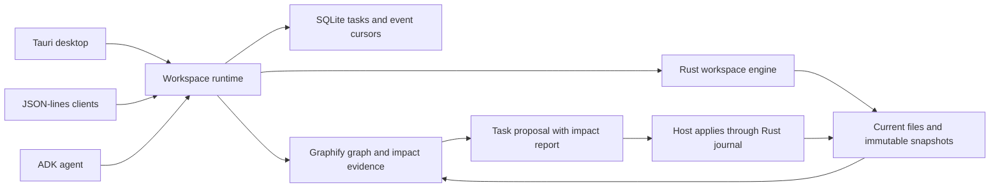

# Coherent workspace runtime

Shark now has one application gateway for the desktop, headless clients, and ADK. It joins the Rust source authority to Graphify indexing and a persisted task workflow.



## Setup

Install Python 3.12 and uv, then run:

```sh
npm run backend:setup
npm run backend:dev
npm run backend:test
```

The setup builds the native binary and installs locked Python dependencies into `backend/.venv`. The Graphify package is **graphifyy 0.9.99**; ADK is **google-adk 2.13.0**. No Graphify skills or agent hooks are installed. Only its deterministic AST extraction API is invoked; documentation/media LLM extraction and cloud services are not used.

Desktop `backend_request` uses this same Python gateway. `SHARK_RUNTIME_PYTHON` and `SHARK_CORE_BINARY` override the development paths. The current desktop wiring assumes a development checkout; a distributable Python environment/native sidecar bundle is still packaging work. The underlying `shark-backend` CLI remains available for native tools alone.

One application runtime owns a workspace at a time. A second gateway receives `runtime_busy`; manual editor saves and native clients still coordinate using Rust's writer lock and content checks. Switching workspaces keeps a separate runtime per open root.

## The workflow

Send one JSON request per line; responses preserve the request ID:

```json
{"id":1,"method":"task/create","params":{"goal":"Change arithmetic in add"}}
{"id":2,"method":"task/context","params":{"id":"TASK_ID","query":"add"}}
{"id":3,"method":"file/read","params":{"path":"src/math.ts","start_line":1,"limit":80}}
{"id":4,"method":"task/propose","params":{"id":"TASK_ID","changes":[{"kind":"edit","path":"src/math.ts","expected_version":"VERSION_FROM_READ","edits":[{"kind":"replace","old":"a+b","new":"a-b"}]}]}}
{"id":5,"method":"task/apply","params":{"id":"TASK_ID"}}
{"id":6,"method":"task/events","params":{"id":"TASK_ID","after":0}}
```

`task/list` retrieves the most recent persisted tasks for the desktop sidebar; `task/get` returns their full goal. `task/propose` returns the native change preview and a reverse-dependency impact report together. Source files stay untouched until the host calls `task/apply`. If any indexed dependency changes between proposal and apply, the task refuses application with `analysis_stale`, even when the changed file was outside the proposed edits. Prepare a fresh proposal after inspecting new evidence. Rust independently checks each edited file's version.

`changes/analyze` adds an impact report to an existing native proposal; `changes/inspect` retrieves the proposal's status. Low-level native apply/revert/recovery remain host operations. An apply interrupted between writing files and recording task state can be reconciled through `task/get.proposal_status` and the native journal. Applying source edits is not atomic with task-database updates. After an apply, the next graph query refreshes the index; this avoids conflating a graph rebuild failure with a source commit failure.

Tasks, review pointers, and event cursors survive restart in `.shark/runtime.sqlite`. ADK owns `.shark/adk.sqlite` for its session history. Running tasks become interrupted after process restart; no model invocation automatically resumes. Completed proposals remain available for review. Event pages are bounded and use a monotonically increasing cursor; partial model text is labeled `text_delta`, while completed text events are labeled `text` and may repeat the partial content.

## Graph and quick exploration

- `graph/index`: build or reuse the current index; optional `force` requests extraction again.
- `graph/query`: lexical ranking over symbol names and paths, returning a bounded neighborhood. This is not semantic vector search or LLM question answering.
- `graph/impact`: reverse dependency traversal from `paths` or an exact `node_id`, with depth 1–6 and result limits. Each affected node includes its dependency path and weakest confidence.
- `workspace/context`: graph retrieval with guidance for current-source reads and the proposal handoff.

Each node carries its source path/location, BLAKE3 version, and historical artifact ID. Graphify's `EXTRACTED` and `INFERRED` labels remain visible. Unresolved endpoints, skipped files, declined files, and unindexed file counts appear in coverage. Static reachability is not a guarantee of runtime effects, complete reference resolution, or test coverage. Symbol-level traversal excludes containment edges to avoid treating siblings as dependents.

Graph providers receive copied immutable snapshots from the Rust workspace boundary, never the live source tree. Snapshots respect inventory exclusions, reject symlinks, and cap text at 64 MiB. This provider indexes common code extensions plus selected package/compiler manifests; it caps inputs at 5,000 files and graph size at 100,000 nodes/300,000 edges. Unsupported formats are reported as unindexed, not silently treated as fully analyzed.

The runtime checks current input content before each graph query. Unchanged revisions reuse the persisted normalized graph without starting Graphify. Changed revisions run cross-file extraction again; Graphify also maintains its own per-file AST cache where supported. JavaScript/TypeScript extraction can bypass that provider cache for cross-file correctness. This is not a file-watcher-backed incremental graph or a constant-time query freshness check: current files must still be read and hashed. A change during extraction aborts publication. Failure retains the previous graph on disk but returns an explicit error rather than serving it as current. Extraction runs in an isolated subprocess with a 120-second timeout. Bounded responses expose truncation; narrowed follow-up queries retrieve more evidence. Cache/snapshot/journal retention remains manual.

## ADK

Set backend environment credentials using `GOOGLE_API_KEY`, `GEMINI_API_KEY`, or Vertex AI configuration. Configure `SHARK_MODEL` or supply `model` in `agent/start`; no model ID is assumed.

```json
{"id":7,"method":"agent/start","params":{"id":"TASK_ID","model":"YOUR_CONFIGURED_GEMINI_MODEL"}}
{"id":8,"method":"task/events","params":{"id":"TASK_ID","after":0}}
{"id":9,"method":"agent/cancel","params":{"id":"TASK_ID"}}
```

ADK uses an App, Runner, database sessions, streaming events, cancellation, and a 30-call invocation limit. The model can explore, read, search, assess impact, and propose changes. It has no apply, arbitrary dispatch, shell, or validation tool. The calling desktop/CLI workflow owns the review handoff. There is one model invocation per workspace. No key is stored by this runtime; provider exceptions are recorded as codes/types rather than raw credential-bearing payloads.

Tests exercise the real ADK Runner and Graphify extractor using an offline scripted model, including exploration → source read → proposal → host application, persistent ADK sessions, and cancellation. No live provider, billed tokens, or quota savings have been measured. Language-server semantic refactoring, validation execution, process sandboxing, external CLI-agent adapters, and the in-thread follow-up steering remain next steps. The frontend now uses the shared task, event and review APIs; Graphify is reserved for agents and has no human explorer UI. Shared ContextDB selection remains deferred.

Agent proposals now persist optional `summary` and `review_notes` fields alongside the proposal identity. The ADK proposal tool requires both: a plain-language behavior description and truthful verification guidance. The UI presents these before file/dependency details and optional code. Older or externally prepared tasks without a summary are shown explicitly as missing an explanation, and their UI apply control is disabled until a clear proposal is supplied.


## Static analyzers

`tools/detect` lists built-in checks and verified external binaries. `builtin` means the
check ships in the runtime; `callable` means `tools/analyze` accepts its ID. Missing
external tools return `status: unavailable` with setup details in `tools/detect`.

```json
{"method":"tools/analyze","params":{"tool":"python-syntax"}}
{"method":"tools/analyze","params":{"tool":"code-stats"}}
{"method":"tools/analyze","params":{"tool":"ast-grep","pattern":"console.log($A)","language":"javascript"}}
```

The other analyzer IDs are `semgrep`, `scc` and `ctags`. Engines access this gateway
through MCP (`shark_static_tools`, `shark_analyze`) or API agent tools (`static_tools`,
`analyze_code`). Desktop callers use `sharkIntelligence.analyze`.

Checks inspect the current workspace, not pending edits in an engine's private copy.
Native inventory exclusions apply. Files over 2 MiB, non-UTF-8 files and binary files
are skipped; total input is capped at 16 MiB. Results report skipped counts. External
tools receive a temporary source snapshot with no project execution or rewrite flags.
Calls time out after 60 seconds and return at most 24,000 stdout bytes plus 4,000
stderr bytes. External result paths have a `source/` prefix. Truncated stdout may be
incomplete JSON. These checks are not a process sandbox.

Semgrep uses a Shark-owned offline rule for dynamic `eval` calls with metrics and
version checks disabled. It does not fetch remote rules or use workspace Semgrep
configuration. It is not a comprehensive vulnerability scan. Third-party binaries
are detected on the host and are not bundled by `build-sidecars.sh`. Python syntax
checks and extension-based file/line/byte statistics require no additional binaries.


## Bundled project intelligence

The core gateway exposes `intelligence/status`, `index`, `structure`, `search`, `explain`,
`dependencies`, `impact`, `quality`, `security`, `architecture`, `history`, `runtime`,
`context` and `artifact`. Detailed schemas, methodology and outstanding product work
are recorded in [core capability status](../architecture/core-capability-status.md).
The intelligence API was introduced in runtime capability version 5; durable workflows require version 6.

Reports carry a source revision and source-manifest artifact, plus provider, coverage,
limitations and a retained report artifact. Retrieval is ranked lexical; security results
are review candidates. Runtime ingestion accepts supplied measurements and does not
collect them itself. Advisory matching requires supplied exact-version records; there
is no bundled vulnerability database yet.

Each CLI run gets a dedicated workspace Service and bridge for its candidate copy.
Reports and immutable source artifacts are retained in the parent task's workspace
before cleanup. A content change in the original workspace during the run prevents
proposal creation. This is source-version coordination, not an OS process sandbox.

MCP exposes `shark_project` and `shark_read_file`; API agents receive
`project_intelligence`. Data imports remain host-only. The existing native and Graphify
APIs stay available during migration.
